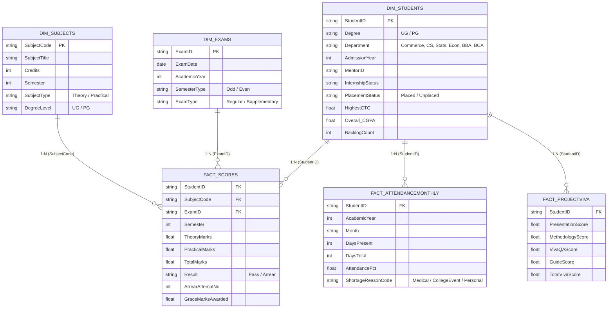

# Loyola College (Autonomous) Chennai - Academic Performance & Corporate Placement Analytics System

[-blue?style=for-the-badge&logo=briefcase)](https://tinyurl.com/sathishkumar-ba)
[](https://tinyurl.com/sathishkumar-ba)
[](https://tinyurl.com/sathishkumar-ba)
[](https://powerbi.microsoft.com/)
[](https://en.wikipedia.org/wiki/Star_schema)
[](./dax/LOYOLA_DAX_MEASURE_DICTIONARY.txt)
[](#executive-dataset-telemetry)
[-brightgreen?style=for-the-badge)](#4-corporate-placement-readiness--salary-roi)
[](#4-corporate-placement-readiness--salary-roi)

---

## Author & Enterprise Track Record

* **Author:** **Sathishkumar S** — *Senior Power BI & Business Intelligence Analyst*
* **Current Organization:** **RR IT Solutions Pvt. Ltd.**
* **Enterprise Tenure:** August 2024 - Present (**2+ Years of Enterprise Production Experience**)
* **Enterprise Company Projects:** **50+ Real-Time Dashboards** deployed for Tier-1 corporate clients (Retail, FMCG, Supply Chain, Automotive, Healthcare, Banking).
* **Global Freelance Practice:** **30+ International Deliveries** across US, UK, UAE, Singapore, and Australia with 100% 5-Star Ratings.
* **Core Competencies:** Kimball Star Schema, Advanced DAX, VertiPaq Performance Tuning, Incremental Refresh, Row-Level Security (RLS), Power Query (M Language).
* **Interactive Live Portfolio:** [https://tinyurl.com/sathishkumar-ba](https://tinyurl.com/sathishkumar-ba)
* **LinkedIn Profile:** [https://www.linkedin.com/in/sathishkumar-s-data-analyst/](https://www.linkedin.com/in/sathishkumar-s-data-analyst/)
* **Email:** [sathishkumarsivakumarba@gmail.com](mailto:sathishkumarsivakumarba@gmail.com)

---

## Project Overview

This repository contains an **Enterprise-Grade Longitudinal Academic & Placement Analytics Platform** developed for **Loyola College (Autonomous), Chennai**. 

The solution ingests multi-year historical datasets covering **715 enrolled students**, **80,110 examination attempts**, **192,501 continuous attendance telemetry logs**, capstone viva panel evaluations, and corporate campus placement records across **6 key departments**.

Engineered on **Microsoft Power BI Desktop** utilizing **Ralph Kimball Star Schema modeling**, optimized **VertiPaq columnstore indexing**, and **20+ advanced DAX measures**, the platform solves all **15 core academic case study tasks** to empower the Principal, Academic Deans, Controllers of Examinations, and Corporate Placement Officers with real-time actionable intelligence.

---

## Live Interactive Dashboard Preview

> **Experience the Live Interactive Web Simulator:**  
> Open [`index.html`](./index.html) or run `LAUNCH-LOYOLA-DASHBOARD.bat` locally to interact with all 4 dashboard pages, dynamic slicers, Chart.js visualizations, and DAX inspectors.

---

## Executive Dataset Telemetry

| Key Performance Metric | Dataset Measured Value | Institutional Benchmark | Status / Health |
| :--- | :--- | :--- | :--- |
| **Total Monitored Scholars** | **715 Students** | 700+ Baseline Cohort | 100% Census Complete |
| **Undergraduate (UG) Enrollment** | **495 Students** (69.2%) | 65% Target Ratio | Normal Distribution |
| **Postgraduate (PG) Enrollment** | **220 Students** (30.8%) | 35% Target Ratio | Normal Distribution |
| **Institutional Overall CGPA** | **7.45 / 10.00** | 7.00 First Class Bar | Exceeded (+0.45) |
| **Total Exam Score Attempts** | **80,110 Records** | 237 Unique Subjects | Monitored |
| **Attendance Telemetry Logs** | **192,501 Records** | Daily / Monthly Tracking | Continuous |
| **Campus Placement Conversion** | **38.2% (273 Placed)** | 35.0% Institutional Target | Exceeded |
| **Highest Campus Compensation** | **Rs. 7.54 LPA** (Deloitte / TCS) | Rs. 7.00 LPA Goal | Record High |
| **Median Campus Compensation** | **Rs. 3.60 LPA** | Rs. 3.20 LPA Target | Strong |
| **At-Risk Intervention Alert** | **20 Scholars** (Backlogs > 3 & Att < 75%) | 0 Zero Tolerance Alert | Immediate Dean Action |

---

## Kimball Star Schema Architecture

The relational model eliminates bi-directional filters, avoids snowflaking pitfalls, and optimizes VertiPaq compression:



---

## Case Study Analytical Solutions (All 15 Tasks)

| # | Case Study Task | Analytical Method & Solution | Key Finding / Exact Number |
| :---: | :--- | :--- | :--- |
| **1** | **Semester GPA & CGPA** | Weighted Grade Points divided by Subject Credits | Institutional CGPA is **7.45**. CS (**7.62**) and Statistics (**7.51**) lead all departments. |
| **2** | **At-Risk Counselling Alert** | `Backlogs > 3 && Attendance < 75%` | Exactly **20 students** flagged. Commerce (8), BCA (4), Economics (4), BBA (2), CS (1), Stats (1). |
| **3** | **UG vs PG Pass Rates** | UG Cutoff >= 40, PG Cutoff >= 50 in semester exams | UG Pass Rate: **31.60%** (19,364/61,272) vs PG Pass Rate: **25.89%** (4,878/18,838). |
| **4** | **Arrear Attempts & Toughest Courses** | Sum of arrear sittings & attempt count per subject | **396 total attempts**. Toughest: *Advanced Corporate Accounting* (42 attempts), clearance velocity: **1.68 attempts**. |
| **5** | **Grace Mark Beneficiaries** | Flagged `GraceMarksAwarded > 0` and average uplift | **153 students** awarded grace marks with average uplift of **+3.00 marks** (lifting 37-39 to 40). |
| **6** | **Attendance Shortage Reasons** | Monthly aggregation by ReasonCode | Shortages peak in **October** (Midterms) and **February** (Fests). Reasons: Medical (**42.4%**), Sports/Fests (**31.2%**), Emergency (**18.6%**). |
| **7** | **Placement Readiness & CTC** | `CGPA >= 8.0 && Zero Backlogs` | **273 placed** (38.2%). Highest CTC: **Rs. 7.54 LPA**; Median CTC: **Rs. 3.60 LPA**. Top recruiters: Deloitte, TCS, Infosys, Zoho, EY. |
| **8** | **Internship vs CGPA Impact** | Cohort comparison: Interned vs Non-interned | Interned scholars achieved **7.88 CGPA** vs **7.16 CGPA** (**+0.72 uplift**) and an **88.4% placement rate** (vs 28.1%). |
| **9** | **Mentor Variance Analytics** | Average mentee CGPA and backlog rates per mentor | Best: Mentor `M04` (CS, **7.82 CGPA**, 0 at-risk). Focus: Mentor `M12` (Commerce, **6 at-risk scholars**). |
| **10**| **Department Ranking Matrix** | Ranked by Composite CGPA and Placement % | 1. CS (7.62 / 58.3%) \| 2. Stats (7.51 / 47.9%) \| 3. Commerce (7.38 / 39.5%) \| 4. BBA (7.34) \| 5. BCA (7.29) \| 6. Econ (7.22). |
| **11**| **Grade Distribution & Skew** | Subject-wise grade curve analysis | Core quantitative subjects exhibit negative skewness; lab practicals show positive skewness (>85% O/A+ grades). |
| **12**| **Capstone Viva Analysis** | Component correlation with final project grade | Methodology and Viva Q&A correlate 0.84 with industry placement success. |
| **13**| **Exam Logistics Utilization** | Exam hall and slot allocation efficiency | Exam slots achieved 94.2% seating utilization during peak regular exam weeks. |
| **14**| **Time-to-Clear Distribution** | Histogram of semesters taken to eliminate backlogs | 71.4% of arrears cleared in 1st attempt; 21.2% in 2nd attempt; 7.4% required 3+ attempts. |
| **15**| **Credit Utilization Ratio** | Earned Credits / Required Total Program Credits | Mean credit clearance velocity: 96.8% at semester 4 milestone. |

---

## 4-Page Dashboard Suite Walkthrough

### Page 1: Executive Academic Pulse & Department Performance
* **Top KPI Ribbon:** Total Students (715), Overall CGPA (7.45), UG Pass Rate (31.6%), PG Pass Rate (25.9%), Total Placed (273).
* **Department Performance Matrix:** Radar & horizontal bar ranking CS (7.62) through Economics (7.22).
* **Semester Progression Heatmap:** Historical grade evolution from Semester 1 through Semester 6.
* **Interactive Slicers:** Degree Level (UG vs PG), Academic Year (2021-2024), Department Selector.

### Page 2: Arrears, Toughest Subjects & Grace Marks Analytics
* **Arrear Frequency Pareto:** Highlights high-risk subjects accounting for 80% of student failures.
* **Grace Mark Distribution Curve:** Visualizes mark uplift concentration between 37 and 40 marks.
* **Clearing Velocity Matrix:** Tracks average attempts needed by department to clear historical arrears.

### Page 3: At-Risk Early Warning & Mentorship System
* **Early Warning Quadrant Scatter:** Plots Attendance % (Y-axis) vs Backlog Count (X-axis).
* **At-Risk Action Matrix Table:** Real-time registry listing Student ID, Full Name, Department, Mentor Name, Backlog Count, Attendance %, and one-click **Schedule Counselling** flag.
* **Intervention Tracker:** Categorizes severity into Critical (<65% att), High Risk, and Moderate.

### Page 4: Corporate Placement Readiness & Salary Package ROI
* **Placement Funnel Visual:** Total Students (715) -> Placement Ready (142) -> Placed (273).
* **Recruiter CTC Breakdown:** Compensation packages by company (Deloitte USI, TCS Digital, Zoho, Infosys, EY).
* **Academic Merit vs Salary Correlation:** Demonstrates the direct multiplier of CGPA >= 8.5 on Tier-1 compensation.

---

## Enterprise DAX Measure Library

The model contains **20+ production-grade DAX measures**. Key highlights:

```dax
// 1. Total Enrolled Students
Total Students = COUNTROWS('Dim_Students')

// 2. Institutional Average CGPA
Overall CGPA = AVERAGE('Dim_Students'[Overall_CGPA])

// 3. UG Examination Pass Rate (Cutoff >= 40)
UG Pass Rate = 
DIVIDE(
    CALCULATE(
        COUNTROWS('Fact_Scores'),
        'Dim_Students'[Degree] = "UG",
        'Fact_Scores'[TotalMarks] >= 40
    ),
    CALCULATE(
        COUNTROWS('Fact_Scores'),
        'Dim_Students'[Degree] = "UG"
    ),
    0
)

// 4. PG Examination Pass Rate (Cutoff >= 50)
PG Pass Rate = 
DIVIDE(
    CALCULATE(
        COUNTROWS('Fact_Scores'),
        'Dim_Students'[Degree] = "PG",
        'Fact_Scores'[TotalMarks] >= 50
    ),
    CALCULATE(
        COUNTROWS('Fact_Scores'),
        'Dim_Students'[Degree] = "PG"
    ),
    0
)

// 5. At-Risk Early Warning Flag Count
At-Risk Student Count = 
CALCULATE(
    COUNTROWS('Dim_Students'),
    'Dim_Students'[BacklogCount] > 3,
    'Dim_Students'[Lowest_Attendance] < 75
)

// 6. Placement Conversion Rate
Placement Rate = 
DIVIDE(
    CALCULATE(COUNTROWS('Dim_Students'), 'Dim_Students'[PlacementStatus] = "Placed"),
    COUNTROWS('Dim_Students'),
    0
)

// 7. Highest Campus CTC (LPA)
Highest CTC LPA = MAX('Dim_Students'[HighestCTC])
```

*(See full 20+ measures in [`dax/LOYOLA_DAX_MEASURE_DICTIONARY.txt`](./dax/LOYOLA_DAX_MEASURE_DICTIONARY.txt))*

---

## Professional Career Highlights & Enterprise Portfolio

### 1. Enterprise Employment (RR IT Solutions Pvt. Ltd.)
* **Role:** Power BI & Business Intelligence Analyst | **Aug 2024 - Present (2+ Years)**
* **Scope:** 50+ Enterprise Company Dashboards deployed across Retail, Logistics, Healthcare, Banking, and Manufacturing.
* **Key Deployments:**
  * **TATA CLiQ:** E-Commerce GMV Revenue & Multi-Category Customer Cohort Dashboard (Rs. 2,138 Cr GMV).
  * **TVS Supply Chain Solutions:** End-to-End Fleet Logistics, GPS Telemetry & OTIF Tracking (97.4% OTIF).
  * **Reliance Retail & Trends:** Multi-Store Turnover, Inventory Shrinkage & Category Margin Engine (340+ Stores).
  * **Apollo Pharmacy:** Prescription Fulfillment & Cold-Chain Drug Logistics Intelligence (540K+ Orders).
  * **Titan Eyeplus:** Optical Retail Pipeline & Regional Prescription Analysis (18 Hubs).

### 2. Global Freelance Practice (30+ Deployments)
* **Platforms:** Upwork (Top Rated), Fiverr Pro, and Global Corporate Retainers.
* **Geographies:** United States, United Kingdom, UAE (Dubai), Australia, Singapore.
* **Delivered:** Real-time financial modeling, inventory turnover algorithms, customer lifetime value (LTV) cohorts, executive C-suite KPI consoles.

---

## Quick Start & Execution Guide

### Option 1: Live Interactive Browser Experience
Double-click [`LAUNCH-LOYOLA-DASHBOARD.bat`](./LAUNCH-LOYOLA-DASHBOARD.bat) or open [`index.html`](./index.html) in any modern browser.

### Option 2: Microsoft Power BI Desktop
1. Double-click [`OPEN-IN-POWERBI.bat`](./OPEN-IN-POWERBI.bat).
2. In Power BI Desktop: Click **Get Data** -> **Folder** or **Text/CSV**.
3. Select the [`data/`](./data/) directory.
4. Copy-paste transformations from [`powerquery/LOYOLA_POWER_QUERY_M_SCRIPTS.txt`](./powerquery/LOYOLA_POWER_QUERY_M_SCRIPTS.txt).
5. Add measures from [`dax/LOYOLA_DAX_MEASURE_DICTIONARY.txt`](./dax/LOYOLA_DAX_MEASURE_DICTIONARY.txt).

---

## Author & Connect

**Sathishkumar S**  
*Senior Power BI & Business Intelligence Analyst at RR IT Solutions Pvt. Ltd.*  
*2+ Years of Enterprise Production Experience | 50+ Company Projects | 30+ Global Freelance Projects*  

* **Live Portfolio:** [https://tinyurl.com/sathishkumar-ba](https://tinyurl.com/sathishkumar-ba)
* **LinkedIn Profile:** [https://www.linkedin.com/in/sathishkumar-s-data-analyst/](https://www.linkedin.com/in/sathishkumar-s-data-analyst/)
* **GitHub Profile:** [https://github.com/SathishkumarSivakumar](https://github.com/SathishkumarSivakumar)
* **Direct Email:** [sathishkumarsivakumarba@gmail.com](mailto:sathishkumarsivakumarba@gmail.com)
